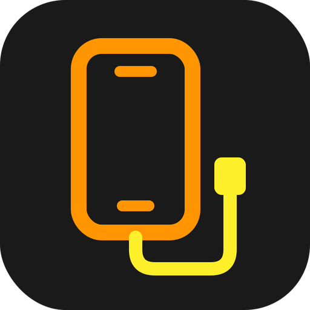
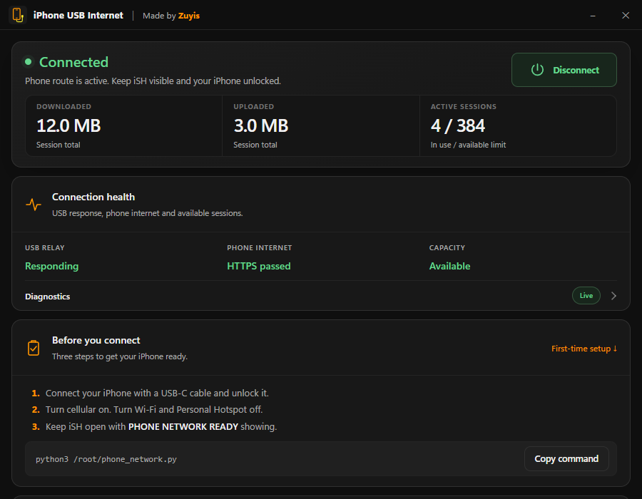
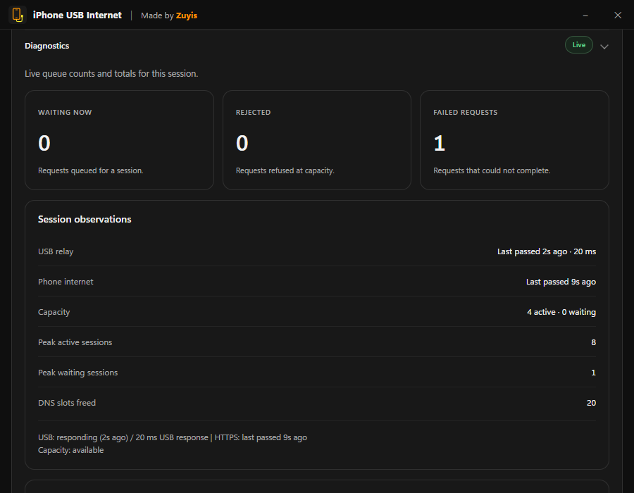

# iPhone USB Internet

Connect your Windows PC through your iPhone over USB, with connection controls and diagnostics in one place.

Made by **Zuyis**. iPhone USB Internet pairs a Windows desktop app with an
[iSH](https://ish.app) relay on your iPhone. Prepare your phone, check the
connection, then connect when you choose: **pair → check → connect**.

**[Download iPhone USB Internet 1.2.0 for Windows](https://github.com/dukagjina/iPhone-USB-Internet/releases/download/v1.2.0/iPhone-USB-Internet-Setup.exe)**

[Release notes & checksums](https://github.com/dukagjina/iPhone-USB-Internet/releases/tag/v1.2.0) ·
[Installation help](INSTALL.md) ·
[Report a problem](https://github.com/dukagjina/iPhone-USB-Internet/issues/new)

**Requirements:** Windows 10/11 x64, WebView2, Apple device support, an iPhone
with iSH and Python, and a USB data cable. Keep iSH visible and the phone
unlocked while connected. Version **1.2.0** is an **experimental prerelease**;
the installer is **unsigned**. See [installation help](INSTALL.md).

**Educational Purposes Only.** Carrier billing and hotspot classification are
unverified. Follow your carrier agreement and applicable laws. Read the
[educational-use notice](EDUCATIONAL%20USE.txt).

## Screenshots

The dashboard and diagnostics in **1.2.0**. These screenshots use invented
demonstration values, with no personal phone identifiers or pairing data.
Select an image to view it at full size.

**Connection dashboard**

<strong>Connection diagnostics</strong> — queues, failed requests and session observations

## What you can do

| Area | Tools |
| --- | --- |
| Connection | Check your phone, connect manually and disconnect from one dashboard. Opening the app never connects. |
| Traffic & sessions | See downloaded and uploaded totals, active sessions and the 384-session limit. |
| Connection health | Check USB relay response, phone internet availability and session capacity. |
| Diagnostics | Inspect waiting, rejected and failed requests, plus peak session counts and recent health checks. |
| Setup & maintenance | Pair your iPhone, prepare its receiver command and send the phone relay over USB. |
| Desktop app | Use Start menu and Desktop shortcuts, a saved window position and a standard Windows uninstaller. |

This is not a VPN or kill switch. Other enabled connections can still be used;
some apps, games and VPNs need separate compatibility testing. See
[connection behavior and limits](INSTALL.md#connection-behavior-and-limits).

## Get started

1. Download **iPhone-USB-Internet-Setup.exe** using the link above and install it.
2. Install Apple Devices on Windows and iSH Shell on your iPhone. In iSH, run `apk add python3`.
3. Open **Setup & maintenance** in the app to pair your phone and send the relay. Follow the [first-time setup guide](INSTALL.md#first-time-phone-setup).
4. Run `python3 /root/phone_network.py` in iSH. Keep cellular on, Wi-Fi and Personal Hotspot off, and wait for **PHONE NETWORK READY**.
5. Choose **Check phone**, then **Connect PC**, and approve Windows permission when you are ready.

Setup installs for your Windows account. Uninstall through **Windows Settings →
Apps → Installed apps → iPhone USB Internet**. Local pairing and preferences
are retained for reinstallation; see [installation help](INSTALL.md#uninstall).

## Privacy, support and license

No telemetry or browsing-history database is implemented. Windows pairing data
is encrypted for your account; local diagnostics contain session counters and
errors. The phone internet health check contacts Cloudflare. Read the full
[privacy notice](PRIVACY.txt).

For ordinary problems, [open an issue](https://github.com/dukagjina/iPhone-USB-Internet/issues/new)
with your app version, Windows version and the visible error. Do not post
pairing files, receiver commands or the installed phone relay; they contain
private credentials.

Free for personal and other permitted noncommercial use under the
[PolyForm Noncommercial License 1.0.0](LICENSE). Commercial use requires
separate permission from Zuyis; see [commercial-use terms](COMMERCIAL_USE.txt).
[Third-party notices](THIRD%20PARTY%20NOTICES.txt) and
[trademark terms](TRADEMARKS.txt) apply. This independent project is not
affiliated with Apple, Microsoft, iSH or any carrier.

The repository includes the application source and build tools. See
[developing and building](docs/BUILD.md) to work on the project. To install the
app, download the **EXE asset**; the source ZIP is for development.
